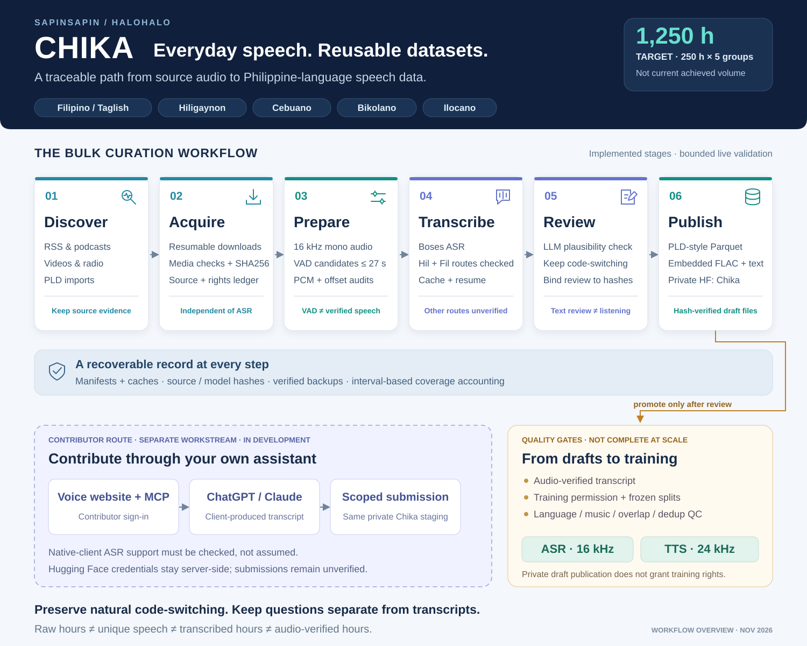

# Chika: repeatable speech curation

[Architecture overview](workflow_architecture.md) · [Infographic PNG](diagrams/chika-workflow.png) · [Tracking issue](https://github.com/sapinsapin/halohalo/issues/8)



Target: approximately **250 unique retained, transcribed hours each** for Filipino/Taglish, Hiligaynon, Cebuano, Bikolano and Ilocano: **1,250 hours overall, not achieved volume**. Download every previously identified Hiligaynon archive where public access is available. Continuous radio uses bounded captures. Acquisition takes priority when ASR has problems.

## Current implementation and limits

Implemented: source inventories and resumable acquisition; canonical PLD-compatible manifests; exact-sample preparation and pinned-model VAD; authenticated Filipino/Hiligaynon ASR with bounded live checks; text-only LLM review and content-bound attachment; embedded-FLAC Parquet export; verified private Hub publication and backup; RSS storage supervision; source-interval coverage accounting. The architecture overview maps these responsibilities to modules.

Still required at scale: language, music and overlap checks; acoustic near-duplicate handling; source-balanced frozen splits; broader audio verification; reliable large-scale transcription and review; and all five completed-hour targets. Cebuano, Bikolano and Ilocano ASR routes remain unverified. Filipino/Hiligaynon authentication works, but isolated server finalization timeouts persist. Do not mistake discovery estimates, raw runtime, padded VAD candidates or small integration checks for completed targets. Do not deploy or restart ASR on GB10.

The website/MCP contributor route is a separate workstream in development. It is intended to use contributors' own assistant transcription capabilities, with scoped submissions into the same schema and private staging; it is not an alternative ASR backend already deployed by this bulk workflow.

## Setup

From the halohalo repository root:

```sh
uv venv curation/.venv --python 3.11
uv pip install --python curation/.venv/bin/python -r curation/requirements.txt
```

Install ffmpeg/ffprobe on the host. RSS discovery/downloads require only Python's standard library plus ffprobe. YouTube/archive scripts additionally use yt-dlp when applicable. Credentials are environment variables or external private files, never source files or GitHub issue content.

## Discover and acquire

```sh
python3 -m curation.collect discover --sources curation/sources.json --root curation/outputs/rss
python3 -u -m curation.collect download --root curation/outputs/rss
python3 -m curation.collect status --root curation/outputs/rss

python3 -m curation.collect discover --sources curation/taglish_sources.json --root curation/outputs/taglish/shared
python3 -u -m curation.collect download --root curation/outputs/taglish/shared --max-hours 300 --max-source-hours 50
```

Hiligaynon defaults to the full available feed inventory. Taglish collects 300 candidate file hours, balanced by acquired runtime with a 50-hour/show cap, allowing room for later rejection. Caps may exceed by one episode. Feed availability limits discovery: a feed may expose only recent episodes, so its complete inventory is not necessarily a show's lifetime archive. Source registries include candidate language and evidence; neither filenames nor English show descriptions establish spoken language.

The worker holds an OS lock per root, preventing two writers from downloading the same queue. Completed items survive restarts. Interrupted downloads use HTTP Range only with an ETag/Last-Modified validator; a server returning a full response causes a clean overwrite. Files are renamed only after media probing, then hashed and checkpointed. Unavailable 401/403/404/410 items are logged without bypassing access restrictions. Other failures retry up to three attempts. Re-discovery updates URLs without erasing progress. Errors are queryable in SQLite. Downloaded totals include music, ads and silence until later QC.

The disk floor is 25 GiB, checked during writes. Other workers share that free space; monitor before adding concurrency. Inspect the actual PID and growing file/log before treating a job as running. A worker.json file alone does not prove liveness. RSS workers can be safely restarted with the same command after confirming the prior process has ended. Do not launch duplicates. Radio cannot recover past live intervals; every capture has its UTC interval and termination reason.

## Standard working schema

`curation/schema.py` defines `sapinsapin.speech.v1`; `curation.cli validate` enforces required fields and split checks. JSONL manifests retain:

- PLD-compatible `sentence`, `duration`, `speaker_id`, `speech_type`, `language`, `num_words`, `text_is_prompt`.
- Stable `id`, `source_id`, `recording_id`, original audio path and SHA256, `prompt` separate from transcription, `languages`, `split`, `review_status`, rights and provenance.
- Original model/config/source/split-spec hashes, segments and their timestamp semantics; synthetic provenance must remain explicit.

`sentence` is always spoken-text draft or verified transcript, never an elicitation question. Keep source questions out of both ASR and LLM review inputs. Hiligaynon–English and Filipino–English code-switching, including local affixes on English roots, are valid speech. Do not translate, purify or reject grammatical code-switches. The primary language label does not imply monolingual speech. Annotate additional languages only from evidence.

A text-only LLM review can flag uncertainty and propose exact-span alternatives; it cannot establish that words were spoken. Preserve raw ASR output and model responses. Only an attributable audio review bound to both audio and sentence hashes sets `audio_verified`. Never compute WER/CER using the LLM guess as ground truth. Source facts and opinions are speech content, not claims to fact-correct in transcripts.

## PLD import and export

```sh
python3 -m curation.cli import-pld \
  --drafts pld_spontaneous/outputs/llm_review \
  --reviews pld_spontaneous/outputs/chatgpt_review/complete \
  --output curation/outputs/pld-hil/manifest.jsonl
python3 -m curation.cli validate curation/outputs/pld-hil/manifest.jsonl
curation/.venv/bin/python -m curation.cli export \
  --manifest curation/outputs/pld-hil/manifest.jsonl \
  --audio-root curation/outputs/pld-hil/audio \
  --output curation/outputs/pld-hil/export-v1 --profile curation
```

`curation` exports private drafts at 16 kHz. `asr` exports 16 kHz and `tts` 24 kHz, requiring recorded training permission, audio verification and assigned splits. Upsampling does not improve original bandwidth; original rate is recorded. All profiles embed mono FLAC as `audio={bytes,path:null}` and keep the established core columns. Additive metadata lives in `provenance_json` and a full sidecar JSONL. Output directories are immutable; use a new version directory after correcting inputs. A summary.json is written only once all shards finish; its absence means incomplete export. Source-byte hashes are checked before export. Test reservations remain reserved, and known speakers/recordings/exact source files cannot straddle assigned splits. Unknown speakers are not proof of speaker-disjointness. Near-duplicate checks are still needed.

## Hub storage and restart

Destination: **private `sapinsapin/chika`** until source-specific redistribution rights are resolved. Public availability is not a license for commercial training or redistribution. Keep rights `unknown` when evidence is absent; do not assign a blanket permissive license. Private backup is storage, not a rights determination.

```sh
curation/.venv/bin/python -m curation.hub --root curation/outputs/rss --namespace hiligaynon-rss
curation/.venv/bin/python -m curation.hub --root curation/outputs/taglish/shared --namespace taglish-rss
```

Raw originals use content-addressed paths; each upload is verified against the remote LFS SHA256 and byte length at its returned commit. SQLite is backed up through the SQLite backup API, not by copying an active WAL database. Checkpoint receipts record immutable revisions. This command **does not evict** local audio. Do not remove a local original unless its remote object and acquisition metadata are verified and recoverable. Recovery and explicit verified eviction are available below; automatic storage supervision remains to be completed. At the floor workers pause safely.

GitHub stores code, source registries, aggregate STATUS.json and issue #8, never credentials, private transcripts/questions or audio. At handoff: regenerate status from each live ledger, record worker PID/command and actual liveness, reconcile HF receipts, commit only code/aggregate files, then update the issue. Resume completed stage identities using input bytes plus configuration/model identity, not filenames alone.

## Video archives and radio

```sh
python3 -m curation.acquire_archives --source discover
python3 -u -m curation.acquire_archives --source deditos
python3 -u -m curation.acquire_archives --source all-youtube
python3 -u -m curation.acquire_radio --station bombo-iloilo --seconds 1800
```

Finish the two-worker Deditos pass before adding the serial video archive worker. Discovery rebuilds each scoped public inventory; failure of one source does not erase others. A missing, empty or failed inventory leaves the all-source queue incomplete. The tracked `archive_sources.json` lists coverage and limits. Complete episodes are prioritized before clips, but all accessible scoped items remain queued. Completed recordings are checked by content hash before skipping. A failed YouTube attempt logs the error and does not imply permission to bypass login/geoblocking/access controls. The source-language candidates require later validation.

Radio stations supported by `acquire_radio.py`: `bombo-iloilo`, `bombo-bacolod`, `bombo-roxas`, `rmn-iloilo`, `rmn-bacolod`. Capture intervals are finite and independently recoverable Matroska files. Station endpoints can fail; preserve the failure and retry only when appropriate. Identical network programmes may appear on multiple stations and need acoustic deduplication. DYSI nutrition-school documentation is a discovery lead, not a recovered audio archive.

## Recovery drills

Restore an immutable RSS checkpoint into a **new empty directory**:

```sh
curation/.venv/bin/python -m curation.restore \
  --receipt curation/outputs/rss/hub-checkpoint.json \
  --root curation/outputs/recovered-rss --max-files 1
```

`--max-files 0` restores metadata only. Backed-up but unselected recordings remain `remote`, with no misleading local path. Files without a backup become pending for reacquisition, with original metadata retained in `restore_inventory`. Selected files require remote hash/size and local checksum verification before the recovered directory is atomically published. The command checks SQLite integrity and the free-space floor, defaults to a 2 GiB selected-media budget, and never alters the original root. Restored remote hours still count against acquisition caps; they do not count as locally available audio.

Archive discovery and per-file ledgers can be packed separately:

```sh
curation/.venv/bin/python -m curation.archive_checkpoint pack \
  --root curation/outputs/archive_sources --root curation/outputs/radio \
  --output curation/outputs/checkpoints/archives-v1.tar.gz
```

Use the command's `--help` for verify/restore syntax. The deterministic metadata bundle excludes audio, logs, temporary files and symlinks. It includes a member-level checksum manifest; restoration rejects unsafe paths and non-file entries. Each source file is stable when copied, but independently running workers are not transactionally frozen. All saved PID/status values are historical observations. The bundle belongs in private Hub storage.

## Preparing new recordings

```sh
python3 -m curation.prepare --rss-root curation/outputs/rss \
  --output curation/outputs/prepared-hil --max-recordings 2
python3 -m curation.cli validate curation/outputs/prepared-hil/manifest.jsonl
```

Preparation verifies original bytes, decodes to canonical 16 kHz mono PCM on disk, and creates bounded nonoverlapping FLAC windows with exact sample offsets. It records original hashes, full-recording PCM hashes and configuration/tool identity. Completed windows are reused only when derivative hashes still match; changing preparation configuration requires a new output directory. The ledger publishes a recording only after all its windows succeed.

These are **ASR transport windows**, not asserted speech regions, speaker turns or TTS training utterances. They have `sentence=""`, `asr_status="pending"`, unknown speakers and provisional source language. No ASR-completed hours are claimed. Empty pending text is not a verified silence transcript. VAD/music/overlap QC, diarization, contextual ASR, alignment and acoustic near-duplicate removal still need to run. Full-recording PCM equality catches exact decoded repeats only, not re-encoded clips or network simulcasts. Original media remains available for higher-rate derivatives.

## LLM text review

```sh
python3 -m curation.review --manifest curation/outputs/pld-hil/manifest.jsonl \
  --output curation/outputs/text-review --key-file ~/.nyo/pld-review.key --limit 3
```

The adapter defaults to the working NYO route `glm-5.3-flash-nebius`; base URL and model are configurable. The earlier `glm-5.3-flash` route had an upstream credit failure. Only ID, transcript and provisional source-language hint are sent; questions, speaker identity, local paths and audio are excluded. Empty/pending ASR windows are skipped. Raw responses and validated text reviews stay separate from the source manifest.

Review caches bind text, audio hash, segment offsets, model/base URL and prompt identity. An OS lock prevents duplicate concurrent local requests. A saved raw response can recover after an interrupted commit; malformed responses fail closed. Transport uncertainty can still cause duplicate provider billing on retry without provider-side idempotency support. Errors are logged without keys or response text; private raw responses remain available for inspection.

Prompt v1's live check overflagged a recognizable phonetic English code-switch. Version v2 adds explicit phonetic/code-switch examples and forbids lexical word replacements in suggestions. Suggestions may only alter spacing, punctuation or capitalization; original ASR text is never overwritten. Successful JSON validation establishes an API/schema contract, **not** linguistic accuracy. Small synthetic text-only instruction probes are kept outside the dataset, and cannot establish general Hiligaynon/Taglish quality. Every result remains `text_review_only`, `audio_verified=false`, `human_approved=false`. Audio-based adjudication is still required.


## Reclaiming verified RSS storage

When the acquisition worker has stopped (for example at its disk floor), first upload and verify completed files plus the SQLite checkpoint using `curation.hub`. Then inspect a bounded plan:

```sh
curation/.venv/bin/python -m curation.evict --root curation/outputs/rss --max-files 5
curation/.venv/bin/python -m curation.evict --root curation/outputs/rss --max-files 5 --target-free-gib 40 --apply
```

The default is dry-run. An active downloader's OS lock prevents any eviction; this tool never stops a worker. Every selected item must be present in a checksum-verified immutable checkpoint, whose backup coordinates agree with both the local ledger and current private Hub object. Local SHA256/size/inode checks precede deletion. A durable `remote` transition and journal precede unlink so interruption cannot produce a false claim that a deleted file is local. Interrupted journal entries can be reconciled safely. Recovery archives imported deletion intents as provenance instead of acting on old filesystem paths.

Only completed `.media` originals within the selected RSS root are eligible. Other source directories and derived FLAC windows are untouched. No original audio was evicted during the initial recovery/dry-run checks. Automatic RSS threshold monitoring is available through `curation.supervise`; archive-source reclamation is not yet implemented. Resume the collector only after confirming the previous process ended; remote hours continue to count against its acquisition caps.


## Storage supervisor

Run `curation/.venv/bin/python -m curation.supervise --once` to observe, or `curation/.venv/bin/python -u -m curation.supervise --apply` for the persistent worker. Check `curation/outputs/supervisor/heartbeat.json` before launching another instance. It backs up bounded RSS batches below 40 GiB free and reclaims only verified, idle-root originals toward 45 GiB free. Downloader locks prevent eviction during acquisition. Durable launch guards, cooldowns and retry limits protect restarts. Hiligaynon RSS is uncapped; Taglish retains its 300-hour overall / 50-hour-per-show acquisition caps. These are raw runtime caps, not verified speech totals.

## Authenticated Boses ASR

The deployment source is `aineolab/sapinsapin-voice` at commit `9f341a84a22e3af04f45adc5d8c9fee8cf457af1`. Its current upstream is `wss://d1ve4x2dfkyese.cloudfront.net/v1/asr`. Supply the existing authorized speech credential using `--key-file`; never commit it. The public browser trial relay is separate and is not used for bulk transcription.

```sh
curation/.venv/bin/python -m curation.asr \
  --manifest curation/outputs/prepared-hil/manifest.jsonl \
  --output curation/outputs/asr-client-hil --key-file /path/to/speech-key \
  --language hil --model fw/whisper-large-v3-pld-hil-norm --limit 2 --pace 0
```

For Filipino use language `fil` and model `fw/whisper-large-v3-pld-fil-norm`. The client checks prepared audio hashes, model handshake, complete temporal coverage and matching finalization before publishing draft transcripts. Raw responses and cache identities permit resumable work. Source questions are never sent. Unpaced delivery passed small live pilots; this does not establish sustained service capacity. Automatic server utterance cuts can split a 30-second transport window, so merged text remains a draft requiring segmentation, language checks and listening. Empty responses are recorded separately. ASR success grants neither audio verification nor training rights.

The first larger batch encountered repeated server `finalize_timeout` errors despite successful small pilots. It was stopped; successful draft caches remain reusable and failed windows do not count as transcribed. Resolve service finalization before resuming bulk ASR. The initial new-audio LLM check accepted one text review and rejected one invalid identity/triage response under the strict contract; original transcripts remain unchanged.

Finalized radio captures can be backed up with `curation/.venv/bin/python -m curation.media_backup --root curation/outputs/radio`. This bounded adapter validates local audio against capture receipts, uploads only audio and selected provenance to the existing private dataset, and verifies downloaded bytes at an immutable revision before publishing `hub-media-receipt.json`. It never deletes local audio. A running upload is not a verified backup.

## Use the same schema for archives and radio

```sh
curation/.venv/bin/python -m curation.import_media \
  --archive-root curation/outputs/archive_sources --radio-root curation/outputs/radio \
  --output curation/outputs/imported-media
curation/.venv/bin/python -m curation.prepare \
  --manifest /path/returned/by/import/manifest.jsonl \
  --output curation/outputs/imported-prepared --max-recordings 1 --window-seconds 28
```

The importer checks finalized metadata against actual file hashes, sizes, audio streams and durations. It writes immutable content-addressed snapshots and a report of exclusions and exact-byte duplicates. Rerunning discovers newly completed downloads without changing prior snapshots. Canonical rights, language, split and provenance survive preparation; changed annotations require a fresh preparation output root. These 28-second windows remain transport units, not detected speech or aligned TTS utterances. The first real import contained 29 recordings from 11 sources, 21.3561 measured media hours, with no claim of unique speech or linguistic verification.

## Join text review and export collected drafts

```sh
curation/.venv/bin/python -m curation.attach_reviews \
  --manifest curation/outputs/asr-client-hil/manifest.jsonl \
  --reviews curation/outputs/review-new-hil \
  --output curation/outputs/review-new-hil/joined-manifest.jsonl
curation/.venv/bin/python -m curation.cli export \
  --manifest curation/outputs/review-new-hil/joined-manifest.jsonl \
  --output curation/outputs/new-hil-export-v1 --profile curation
```

Joining requires matching input/configuration, sentence/audio hashes, and the saved provider response. It rechecks the audio bytes and exact review contract, attaches only validated reviews, and reports missing/ineligible rows. It never changes transcripts, rights or split assignments, and never grants audio verification. A changed input requires a new output snapshot; rerunning the same join is idempotent. Invalid model responses stay outside the attached reviews. Curation export includes unreviewed drafts; training export continues to require audio verification and source permission.

## Publish immutable curation exports

```sh
curation/.venv/bin/python -m curation.publish \
  --export-root curation/outputs/new-hil-export-v1 \
  --prefix curation/a-new-versioned-prefix \
  --receipt curation/outputs/publication-receipt.json
```

The target dataset must already exist and be private. The publisher stages only the export summary, canonical manifest, README and explicitly listed Parquet shards; logs and arbitrary files are excluded. It validates file hashes and row consistency, enforces file/byte limits, rejects an occupied prefix, and uses a parent-commit condition to detect concurrent updates. Remote bytes must match at the immutable resulting revision before a receipt is written. Register the new prefix in `docs/cards/chika.md` and upload that card after verification; raw backups should never be listed as train splits. If commit succeeded but verification was interrupted, the explicit `--verify-existing` mode checks that exact prefix without uploading or overwriting it.

The first collected pilot configurations were uploaded at revision `db224906b9ca13c8eb14b382443f9080c99c62d1`. All nine exported/card files passed remote checksum checks; all five rows decoded locally and both configurations loaded through Hugging Face streaming. This validates format/integration only.

## Five-language collection targets

`curation/targets.json` is the shared target and RSS supervision registry: 250 unique retained/transcribed hours each for Filipino/Taglish, Hiligaynon, Cebuano, Bikolano and Ilocano (1,250 hours overall). Raw acquisition limits provide headroom but are not success criteria. Hiligaynon's identified archives remain uncapped as requested. Cebuano uses 300 raw hours with a 75-hour per-show cap. Bikolano and Ilocano currently use 300-hour RSS limits without per-show caps because their discovered sources are scarcer; domain concentration must be measured during curation.

Use the same discover/download/prepare/review/export commands with `cebuano_sources.json`, `bikolano_sources.json`, or `ilocano_sources.json` and isolated `outputs/<language>/rss` roots. `curation.status` and the storage supervisor read all five registered roots. Bikolano is a collection label, not a claim of one uniform variety: retain source variety evidence and uncertainty. RSS preparation carries full source metadata into provenance. New-language Boses ASR routes have **not** been validated, so do not send those languages to the Hiligaynon or Filipino model merely because it accepts a connection.

Text-review prompt v3 adds Cebuano, Bikolano and Ilocano, preserves code-switching and prohibits imposing another language's grammar. Its changed prompt hash separates it from v2 caches. Existing v2 review attachments remain reproducible using their saved configuration and raw responses. This prompt update is not evidence of model accuracy in the added languages; linguistic/audio evaluation remains required.

## Speech-activity candidates

```sh
curation/.venv/bin/python -m curation.vad \
  --manifest curation/outputs/prepared-hil/manifest.jsonl \
  --output curation/outputs/vad-hil-batch-v1 --max-minutes 2 --max-rows 4
```

This stage runs CPU Silero ONNX inference, checks the pinned model SHA256, and creates padded nonoverlapping speech candidates with exact absolute source-sample offsets. It uses the MIT-licensed [upstream model at pinned revision 066409f](https://github.com/snakers4/silero-vad/tree/066409f3d9db45a30d21dfcbf9147826ffdd7052), with our own hysteresis and gap-aware cuts. The maximum is 27 seconds, leaving headroom below the observed Boses automatic cut near 28 seconds. Continuous speech can still require hard cuts; final word alignment remains separate.

Source audio is unchanged. Every derivative starts with empty pending transcription and no inherited text/audio approval. Parent metadata, source questions, rights and frozen splits remain in provenance/the appropriate fields. Output snapshots bind configuration, model/runtime, input manifest and parent hashes; changing any input requires a new output directory. Counts report padded candidate duration, which includes retained silence. VAD does not verify language, music overlap, speaker identity or transcription quality and is not benchmarked on these language groups.

Small real checks covered Hiligaynon, Filipino, Cebuano, Bikolano and Ilocano. Four short Hil/Fil candidates subsequently passed ASR finalization. This is bounded integration evidence, not proof that the earlier bulk server failure is resolved. No new-language ASR route is implied.

## Count source coverage without duplicate windows

```sh
curation/.venv/bin/python -m curation.account \
  --manifest hil=curation/outputs/review-new-hil/joined-manifest.jsonl \
  --manifest fil_taglish=curation/outputs/asr-client-fil/manifest.jsonl \
  --output curation/outputs/coverage-audit.json
```

The audit rechecks audio hashes and unions exact source intervals by original audio hash and language group. Repeated manifests and overlapping windows count once, and cross-group source hashes are flagged. Draft transcripts, recorded review status and audio-verified coverage are separate. Coverage still includes padding and cannot establish unique retained speech: re-encodings, excerpts and simulcasts require acoustic deduplication. Evaluation reservations are never converted to training rows. Target completion is deliberately not inferred from these partial metrics.

## Back up imported archives

```sh
curation/.venv/bin/python -m curation.archive_backup /path/to/imported/manifest.jsonl \
  --state-dir curation/outputs/archive-backup --max-files 4 --max-bytes 536870912
# Add --upload to run the bounded private-Hub backup.
```

The default is a local verification/plan. Upload rechecks full-recording audio hashes, sizes, duration and acquisition metadata, then writes content-addressed originals and sanitized source metadata. Pinned remote LFS hashes or downloaded bytes must verify before a receipt is issued. Local plans, metadata, per-object progress and immutable receipts permit restart after transport failures; already verified objects are reused without another upload. Concurrent repository changes fail the parent-commit condition safely. This adapter never deletes local originals; archive eviction remains a separate unfinished step.

A real 30.021-second Bikol archive backup passed remote verification at commit `9b41b04eca96af05c7d524e327f0af0580117d11`; a second run succeeded with commit creation disabled. Four radio recordings (63,062,567 bytes including metadata) also finished verification, with receipt revision `6bf32ac31fde5c3cb20c9d40012d1169f80a5392`. Local originals remain intact.

The bounded segmented ASR retry uses only the previously prepared Hil/Fil recordings (about two hours total), serial concurrency one, zero transport retries, a 60-second per-window timeout and a two-consecutive-failure stop. Its private state is `outputs/vad-asr-batch-v1/worker.json`; this is an experiment, not an unattended full-corpus ASR rollout. `curation.status` reports its actual process observation and unions its successful source intervals with earlier drafts, so retries do not inflate covered hours.

### ASR connection-reuse investigation

Read-only inspection of `/Users/timsan/nyo-serve` found sequential multi-finalize socket reuse in `bench/ten_e2e.py:148`. In `modules/asr_fw/server.py:198`, finalization clears finalized PCM but preserves the cumulative sample clock; emitted times remain session-relative. The gateway can synthesize `finalize_end` after an error, so a matching ID must never replace error and coverage checks. No wire reset command was found. Local support is not verification of the deployed revision.

A future reuse client must preserve raw wire events, a verified session handshake and exact session-start samples for each item. It must subtract the session offset before applying original-source offsets, exclude cached items from the sent sample clock, wait for each item's valid completion before sending the next, and discard an uncertain session. Receipt/config versions must distinguish this transport. The running batch deliberately retains the tested one-connection-per-item client. The later bounded persistent-client checks below establish protocol compatibility; sustained throughput gains remain unmeasured.

### Persistent ASR client

`curation.asr_session` implements a separate, versioned persistent transport. It defaults to two items, uses one fixed model/language session, and stops on the first uncertain or failed item without retrying. Both per-batch and per-item OS locks protect output. Raw wire events and the checked session handshake remain intact; exact session sample offsets distinguish successive clips from original-source offsets. Cached items send no audio and do not advance the session clock. A completed attempt can recover after an interrupted cache commit; uncertain attempts require reconciliation instead of automatic paid replay.

```sh
curation/.venv/bin/python -m curation.asr_session \
  --manifest /path/to/prepared-candidates.jsonl --output /path/to/new-results \
  --key-file /path/to/speech-key --language hil \
  --model fw/whisper-large-v3-pld-hil-norm --max-items 2
```

Two live Hil and two live Fil items passed on one connection per language, including cumulative-clock checks. Both caches then passed with network connections disabled. This establishes bounded deployed protocol compatibility, not sustained throughput or linguistic accuracy. The existing larger batch remains on the original client. Word timestamps stay in raw session coordinates and are not represented as source-aligned annotations by this client.

### LLM request identity

Prompt/contract v4 uses a deterministic short request identifier for long row IDs. A live v3 rejection was caused by the model mistyping the original 64-character ID. The response must match the short identifier exactly before it is mapped back to the full local ID; no approximate matching or repair is allowed. Full input/audio/text/configuration hashes remain the cache and attachment identity. Historic responses without the encoding field retain their original full-ID contract. Two repeated live checks and five new draft checks passed this contract; that is not an accuracy benchmark or audio verification.

### Additional-language ASR candidates

`curation/asr_candidates.json` records available SapinSapin Cebuano, Central Bikol and Ilocano checkpoints and pinned revisions from the Hub API. The current local serving registry only configures Fil/Hil routes. Candidate model cards declare `cc-by-nc-4.0`; the metadata is not commercial-use clearance. No candidate weights were downloaded or deployed, and no new-language ASR route is claimed. Central Bikol must not be silently used as a label/model for all Bikol varieties.

### First segmented curation snapshot

`hil_collected_vad_200_v1` on private Chika contains 200 ASR draft candidates totaling 489.686 padded seconds. Five validated text-only reviews are attached; no audio approvals were granted. All 200 embedded audio arrays matched their source derivative PCM exactly. The export's five files passed immutable-revision verification at `ae2abab424fcf6535672d3fdcf8a1f11117a07b9`. This snapshot overlaps earlier pilot sources and is not additive unique speech coverage.

Subsequent bounded-batch failures included four `finalize_timeout` responses on candidates lasting 0.588–2.508 seconds. Avoiding the 28-second boundary does not eliminate every server failure. Failed items remain outside completed manifests; no claim of a production server fix is made.

### Transfer and review circuit breakers

New YouTube archive/inventory workers monitor media-byte growth and free disk space during transfers. The default limits are five minutes without media growth, six hours total, and 25 GiB free disk. Logs and metadata do not count as download progress. Failures terminate the worker-owned transfer process group and retain partial downloads for resumption. Existing running workers retain their earlier timeout behavior until their next normal launch; do not restart healthy downloads just to pick up this change.

LLM review stops after two consecutive failures by default (`--max-consecutive-failures`). Successful cached or new reviews reset that counter. Failed reviews stay excluded, and no transcript is rewritten. Publish newly attached reviews under a new immutable export prefix rather than replacing a previously published snapshot.

Operational checkpoint (2026-11-14 UTC): the bounded Hiligaynon batch stopped early with 667 successful drafts (0.44349 padded hours) and nine failures; no automatic restart was made. A separate persistent Filipino session completed 13 drafts (0.00997 padded hours) before its first error and stopped. The 200-row Hiligaynon review run finished with 194 valid text reviews and six failures. A new local manifest at `curation/outputs/collected-hil-vad-200-reviewed-v2/manifest.jsonl` attaches those 194 reviews with zero transcript changes or audio approvals. It overlaps the already published 200-row snapshot and must not be added as new unique audio. The reviewed version is now published as `hil_collected_vad_200_reviewed_v2` in private `sapinsapin/chika`: data revision `040d715a16820092e20c1e5a4bb40fccecee0213`, dataset-card revision `c868cbd6adc8d6bf0394f44b90aeac899c9964ac`. All five remote artifact hashes and all 200 embedded PCM arrays were checked; audio and sentences are unchanged. Loading the pinned configuration through Hugging Face streaming returned exactly 200 rows: 194 `text_reviewed` and six `draft`. Acquisition remains the priority.

### Hiligaynon archive backup checkpoint

The immutable archive import `75c7187cddc5553c419da5b094bf1021f72f7489d126a0958c50ec4582389f53` contains 49 completed recordings from eight sources: 40.72797 measured media hours and 3,342,182,733 bytes. Two incomplete acquisition records were excluded. This is raw media, with no speech/language verification or training permission implied.

A detached backup job was launched under `curation/outputs/archive-backup-hil-49-v1/` with a 100-recording / 4 GiB bound. Inspect its `worker.json`, actual process, log and `state/receipts/` before any recovery; a running marker alone is insufficient. `curation.status` now reports this job's actual process observation and local receipt-file count. Do not equate receipt-file count with newly verified unique recordings. Local originals are retained, and no archive eviction is enabled.

To reproduce the bounded plan against that imported manifest, then upload after inspecting the plan:

```sh
curation/.venv/bin/python -m curation.archive_backup   curation/outputs/imported-media-latest/snapshots/75c7187cddc5553c419da5b094bf1021f72f7489d126a0958c50ec4582389f53/manifest.jsonl   --state-dir curation/outputs/archive-backup-hil-49-v1/state   --max-files 100 --max-bytes 4294967296
# The same command with --upload writes to the existing private Chika repository.
# Do not run it concurrently with the active worker.
```

Re-running after confirmed termination revalidates remote content-addressed objects and resumes missing work. New recordings require a fresh import snapshot; this frozen job does not include later downloads. Status source-interval accounting also includes the persistent Filipino drafts and the published 194-review Hiligaynon manifest, without adding overlapping segments twice.

### Ilocano radio expansion

The [network player](https://www.bomboradyo.com/live-stream) explicitly maps **Bombo Radyo Vigan** to `https://stream.zenolive.com/ebcyau9nz9duv`. Source evidence and rejected alternatives are recorded in `curation/ilocano_radio_sources.json`. The station is an Ilocano candidate; actual speech and code-switching remain unverified. A 30-second smoke capture completed (30.016 measured seconds, 241,268 bytes) and imported successfully with `--language ilo`. A separate two-hour capture was launched, with status under `curation/outputs/ilocano/radio/bombo-vigan/` and launch metadata under `curation/outputs/ilocano/vigan-capture-2h/`.

```sh
curation/.venv/bin/python -m curation.acquire_radio --station bombo-vigan   --seconds 7200 --output curation/outputs/ilocano/radio --min-free-gib 25
curation/.venv/bin/python -m curation.import_media   --radio-root curation/outputs/ilocano/radio --language ilo   --output curation/outputs/imported-ilocano-radio
```

Check actual live processes before starting another capture. Each invocation records a new time interval, not a resume of missed live audio. Keep radio roots separated by provisional language. Import rejects records whose declared acquisition language conflicts with the requested import language, preventing accidental default-Hiligaynon relabeling. Active or incomplete captures are excluded.

Discovery did not justify importing the station website's linked YouTube channel as Ilocano: it is the national Bombo network, with no Ilocano/Vigan/Laoag title matches in the latest 1,000 streams inspected. The local streaming page also embedded the already known Bacolod stream. Neither page location nor a search title is sufficient evidence of the audio's language. A terminated search-result channel was excluded without attempting access circumvention.

### Targeted archive recovery checkpoint

Aksyon recording `1JsYMPNU2z8` had a terminal fixed-one-hour timeout, while the main round-robin collector had moved to other recordings. After confirming no live transfer for that ID, one targeted retry was launched under `curation/outputs/archive-recovery-1JsYMPNU2z8/`. Its previous acquisition record is preserved in `prior-attempt.json`; its one-item inventory and worker state are alongside it. The retry uses the new media-progress/disk guard and existing yt-dlp partials. Other collectors were not restarted. This retry remains incomplete until its final acquisition record and media checksum are verified.

For a future recovery after confirming this retry has terminated, the existing CLI accepts the isolated inventory:

```sh
curation/.venv/bin/python -m curation.acquire_archives --source youtube   --inventory curation/outputs/archive-recovery-1JsYMPNU2z8/inventory.json   --source-id aksyon-streams
```

Do not launch a second transfer for the same ID. Retain the prior record and inspect the current error before retrying; live/upcoming exclusions require fresh discovery, not blind download retries. The default all-source queue does not automatically retry a failed item during the same pass.

The 49-recording archive backup has produced its first verified recording receipt: revision `b53ba777174932bceb4c3883b126460746ca43d1`, two objects totaling 159,443,623 bytes. A separate read-only audit revalidated both objects at that pinned revision. This proves one recording checkpoint, not completion of the full backup; remaining work stays with the existing live worker.

### Source-balanced preparation batch

`curation.prepare --round-robin-sources` cycles sorted source IDs while preserving the original within-source order. It balances recording selection, not hours, speakers or languages. Sources with fewer available recordings can be exhausted first. Without the flag, the previous input order is preserved. `--max-recordings` still limits newly prepared recordings in a run; cached records do not consume that budget, so rerunning a completed preparation command can add further recordings.

A bounded five-language worker was launched at `curation/outputs/five-language-preparation-v1/`, preparing up to ten new RSS recordings per language group, then VAD candidates. The selection audit found approximately 27.1 raw hours across 9 Filipino/Taglish, 8 Hiligaynon, 10 Cebuano, 3 Bikolano and 4 Ilocano sources. Counts and durations are provisional until stage summaries finish. This batch uses low process priority and a 45 GiB disk floor before stages and during preparation. VAD is capped at 600 input minutes per group and 100,000 input windows; it does not certify speech, language, speaker identity or rights. ASR is not invoked.

```sh
curation/.venv/bin/python -m curation.prepare   --rss-root curation/outputs/cebuano/rss   --output curation/outputs/five-language-preparation-v1/ceb/prepared   --max-recordings 10 --round-robin-sources --min-free-gib 45
curation/.venv/bin/python -m curation.vad   --manifest curation/outputs/five-language-preparation-v1/ceb/prepared/manifest.jsonl   --output curation/outputs/five-language-preparation-v1/ceb/vad   --max-minutes 600 --max-rows 100000
```

Do not run these commands concurrently with the active batch. For recovery, inspect actual process state and each stage's return code first; skip completed stages. If preparation is extended after VAD was created, use a new VAD output root because its input/configuration binding is immutable. `curation.status` reports actual worker observation and completed stage summaries. These candidates overlap earlier pilots; use source-interval accounting instead of summing configurations.

The targeted Aksyon retry `1JsYMPNU2z8` completed successfully, measuring 3,400.901 seconds (56.7 minutes). Its acquisition record now contains the completed media hash; the prior fixed-hour timeout record remains preserved in the recovery directory.

### Independent derivative audit

Use `curation.audit_vad` after a VAD stage completes. It reads the independently supplied parent manifest, rechecks parent and candidate file hashes, compares every decoded candidate sample with the exact parent slice, checks relative/absolute offsets and timestamps, rejects duplicate IDs and within-parent overlaps, and checks inherited language, prompt, rights and split metadata. It does not rerun the VAD heuristic or validate speech content, language, transcripts, speakers or rights claims. Only parents referenced by candidates are decoded; silence-only parents may have no candidate.

```sh
curation/.venv/bin/python -m curation.audit_vad   --parents curation/outputs/five-language-preparation-v1/fil_taglish/prepared/manifest.jsonl   --candidates curation/outputs/five-language-preparation-v1/fil_taglish/vad/manifest.jsonl   --report curation/outputs/five-language-preparation-v1/fil_taglish/vad-audit.json
```

Real-data checks passed on all 1,375 earlier Hiligaynon candidates (1.19318 padded hours) all 5,189 new Filipino/Taglish candidates (6.43737 padded hours), and all 2,755 new Hiligaynon candidates (3.52511 padded hours). The Filipino batch began with 859 transport windows / 7.12117 raw hours; 857 windows produced candidates. Candidate runtime is not unique verified speech. Audit reports bind both input manifests by SHA256. Regression tests include a wrong audio slice with a freshly updated checksum, altered timestamps, conflicting embedded parents and changed rights metadata.

### Completed five-language candidate checkpoint

The first source-balanced batch completed all ten preparation/VAD stages successfully. It contains 50 recordings, 27.07428 transport hours and **19,357 candidates / 24.40479 padded hours**. Every exported candidate passed the independent PCM/offset/metadata audit. The machine-readable [preparation checkpoint](../curation/PREPARATION_CHECKPOINT.json) records per-language counts, source counts and input/output manifest hashes.

| Group | Candidate segments | Padded candidate hours |
| --- | ---: | ---: |
| Filipino/Taglish | 5,189 | 6.43737 |
| Hiligaynon | 2,755 | 3.52511 |
| Cebuano | 5,800 | 7.83103 |
| Bikolano | 1,975 | 3.07390 |
| Ilocano | 3,638 | 3.53738 |

These are local pending-ASR candidates, not completed transcribed datasets. Source labels, music/overlap, speakers, rights and acoustic near-duplicates remain unresolved. Parent/source overlap with earlier pilots means these durations cannot be added as new unique retained hours. No additional ASR calls were made for this batch.

A separate text-only review worker at `curation/outputs/collected-hil-remaining-467-v1/` processes the 467 successful Hiligaynon ASR rows outside the earlier 200-row snapshot. Input SHA256 is `43a283cfd684605db7c24eba37aa82443ae792957b1da8c319b39bb2352fd444`. It retains drafts, uses one attempt per item and stops after two consecutive failures. It is still running; inspect actual process and `worker.json`/`worker.log` before recovery. Existing published exports remain unchanged. After termination, attach validated reviews to a new manifest and reconcile those rows with the earlier snapshot before publishing a new combined configuration.

See [ASR incident diagnosis and offline reconciliation](asr_incidents.md) for the distinction between Hiligaynon gateway timeouts and the corrected Filipino usage-telemetry parser failure.

### Embedded-audio publication checks

`curation.publish` now decodes every embedded Parquet audio value before any Hub request. It requires nonempty FLAC PCM16 mono at the profile sample rate (16 kHz curation/ASR, 24 kHz TTS), checks decoded duration against the manifest with the exporter's 0.1-second tolerance, and compares complete `provenance_json` with the manifest plus explicit original/export sample rates. Shard hashes alone do not establish this. Training-profile publication additionally enforces nonempty audio-verified text, recorded training permission and assigned splits, even for a manually constructed export.

Both existing 200-row Hiligaynon exports passed the stronger checks. Tests reject empty embedded bytes, wrong rate or duration, altered provenance and draft rows disguised as a training profile before network calls. These checks establish file/metadata integrity, not transcript accuracy or rights beyond recorded evidence.

The first 100-row Filipino review completed with 99 valid reviews and one unattached failure. All 100 exported PCM arrays match their local derivatives and all transcripts are unchanged. The private export is at `curation/collected-fil-vad-100-v1`, data revision `1250b65d6fe38f3face5f42576d9bff123a414c8`; it contains 292.476 padded seconds. This overlaps earlier Filipino pilot intervals and is not additional unique audio. Publication receipts and audio checks are under `curation/outputs/fil-review-100-v1/`.

The dataset card exposes `fil_collected_vad_100_v1` at revision `0a1441d12d549f03c63d625ad4a1a698d73cb81a`. Pinned Hugging Face streaming returned exactly 100 rows: 99 text-reviewed and one draft. The separate full Filipino pilot v3 subsequently finished all 482 segments with zero failures, 0.5346333 padded transcribed hours and no empty results; this larger set is not yet the published 100-row configuration.

### Backup recovery after a concurrent Hub commit

The 49-recording Hiligaynon backup stopped with an explicit HTTP 412 precondition failure after another dataset commit landed during an upload. Three recordings had already received verified receipts. The failed worker was confirmed absent before resuming the same immutable plan/state directory; its previous terminal state is retained in `curation/outputs/archive-backup-hil-49-v1/worker-attempt-1.json`.

`curation.archive_backup` now retries only explicit HTTP 412 commit conflicts, at most three commit attempts per object. Each retry fetches the current repository privacy/head, verifies whether the same content-addressed object already exists, and rechecks local bytes before committing. Conflicting remote bytes still fail; authentication, rate-limit and generic network errors are not automatically retried. Conflict evidence is recorded under `state/conflicts/`. The existing fixed plan remains 49 recordings / 4 GiB; no local deletion is authorized.

Resumption revalidated three existing audio objects totaling 304,916,101 bytes. It generated additional pinned receipts for those same objects, so six receipt files represented only three distinct recordings at that checkpoint. Deduplicate receipt audio hashes before counting protected recordings or bytes. Full backup completion remains pending with the resumed worker. Fourteen archive-backup tests passed, including rebasing a one-time 412 and stopping after three repeated conflicts.

### Cebuano news archive pilot

The delegated acquisition pilot downloaded two official **Balitang Bisdak** episodes: `TVve_CROifU` (1,891.521 seconds) and `xzryb6E-vK4` (1,733.281 seconds), totaling 1.006889 raw hours / 48,568,079 bytes. Both passed ffprobe and independent SHA256 revalidation. [GMA identifies the show as its Cebuano newscast](https://www.gmanetwork.com/regionaltv/specials/13621/gma-regional-tv-newscasts-balitang-bisdak-and-balitang-amianan-no-1-in-ratings/story/); each video was matched through its official episode page, rather than assigning Cebuano to the entire channel. Exact spoken language remains provisional, including possible English/Filipino/Waray segments. Rights remain unknown.

The [source registry](../curation/cebuano_archive_sources.json) points to preserved page evidence, inventory and download root. The verified receipt is `curation/outputs/cebuano/archive-expansion/pilot-receipt.json`. Canonical import snapshot `f5f8630fd1a176e181f66e5b661f71296df2b35e9a544a0de17a84ef02458a98` contains both recordings, with no exclusions or exact-byte duplicates:

```sh
curation/.venv/bin/python -m curation.import_media   --archive-root curation/outputs/cebuano/archive-expansion --language ceb   --output curation/outputs/imported-cebuano-archive
```

The archive importer expects source subdirectories, so use the parent of `audio/`, not `audio/` itself. The 30 URLs discovered on one publisher index page are candidate episodes/clips, not 30 measured full episodes. Expansion is delegated with a 30-recording / 20-hour ceiling and 45 GiB floor; keep full-episode/excerpt distinctions and overlap uncertainty. No additional hours are claimed until completed downloads are measured. No Cebuano ASR calls have been made.

### Combined Hiligaynon release and completed Cebuano expansion

The [release index](dataset_releases.md) records the new `hil_collected_vad_667_v1` configuration: 667 transcripts, 531 validated text reviews, 136 draft-only rows, 1,596.56 padded seconds. Both prior review directories were independently validated during attachment; sentences and audio stayed unchanged. All 667 embedded PCM arrays, ten remote artifacts and the pinned streamed row/status counts passed verification. This supersets the earlier 200-row Hiligaynon releases; it is not additive unique coverage.

The two review responses that triggered the earlier stop failed consistency checks (a no-issue verdict with flagged issues, and a quoted span absent from the transcript). Neither was repaired or retried. After confirming other review requests were succeeding, a separate bounded worker under `curation/outputs/collected-hil-remaining-125-v1/` started only the previously unattempted 125 rows. Keep its future attachments in a new immutable snapshot.

Cebuano expansion completed all 13 selected clips. Combined with the two full-episode pilots, 15 recordings total 1.463365 raw hours / 70,738,694 bytes. All hashes were rechecked; canonical import snapshot `339c11f38a1f671a472b19c9d905767d89362d63eea3d61066ceaaecd0fa87ce` has zero exclusions or exact-byte duplicates. Acoustic/episode overlap and actual language remain unverified. The [frozen public inventory](../curation/cebuano_archive_inventory.json) preserves all fifteen video IDs, publisher episode URLs, channel identities and full-episode/clip selection scope so reacquisition does not depend on private working files. Upcoming content and conservative same-date candidates remain excluded.


### Reviewed snapshot continuation and next Filipino batch (15 November)

The completed Hiligaynon review join under `curation/outputs/collected-hil-667-v2/` contains 667 rows: 654 validated text reviews and 13 rejected reviews left as drafts. The Filipino join under `curation/outputs/collected-fil-482-v1/` contains 482 rows: 471 validated text reviews and 11 draft-only rows. Both joins preserve transcript text and audio, with zero audio approvals. Their exports passed independent PCM comparisons for every row. See [release evidence](dataset_releases.md) for published configurations and pinned revisions; a local export alone is not publication.

A new bounded review worker under `curation/outputs/fil-review-next-500-v1/` selects 500 nonempty ASR drafts from the ongoing Filipino session, excluding IDs in every earlier Filipino review input. `selection.json` and the input hash freeze the selection. It uses one request attempt per item and stops after two consecutive invalid responses. Inspect the actual process, `worker.json`, and `reviews/summary.json` before recovery. This batch does not retry the eleven previously rejected reviews, and its future results must be attached to a new immutable snapshot.

When a publication receives an explicit HTTP 412, another writer has advanced the Hub branch. Re-run the bounded publisher only after checking its prior process is terminal; it revalidates the export and private repository and refuses a nonempty destination. If the commit succeeded but receipt verification failed, use `--verify-existing` instead. Never overwrite an existing snapshot or restart the acquisition/backup jobs merely to resolve a publication conflict.
