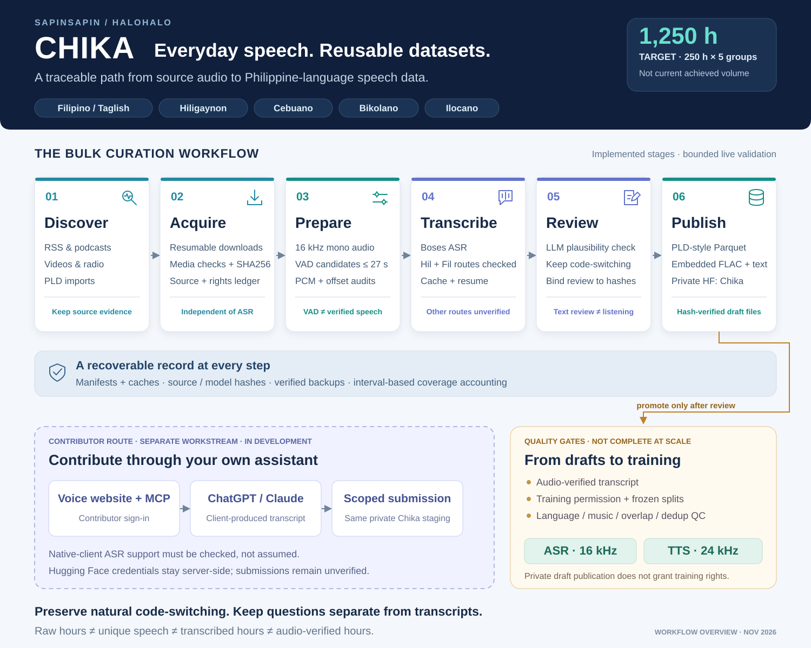

# Chika workflow architecture

Chika turns Philippine-language recordings into traceable, reusable speech datasets. The target is **250 unique retained, transcribed hours for each of five groups**: Filipino/Taglish, Hiligaynon, Cebuano, Bikolano and Ilocano. **1,250 hours is a target, not achieved volume.** Bikol varieties and uncertain source-language labels remain explicit.



[Download PNG](diagrams/chika-workflow.png) · [Editable SVG](diagrams/chika-workflow.svg) · [Operational playbook](dataset_curation.md) · [Live checkpoint files](../curation/STATUS.json) · [Tracking issue](https://github.com/sapinsapin/halohalo/issues/8)

Architecture snapshot: **14 November 2026**. The graphic describes responsibilities and boundaries; it is not a live progress dashboard.

## Read the diagram

The solid top row is the implemented bulk-curation path. Each stage produces evidence that the next stage can validate. Live ASR checks cover Filipino and Hiligaynon; the other language routes are not verified. Server timeouts remain possible, so failed items stay outside completed manifests.

The dashed contributor route is a **separate workstream in development**. Its intended website/MCP flow uses a transcript produced through the contributor's ChatGPT or Claude capabilities, rather than Boses ASR. Native-client ASR support must be established rather than assumed. Submissions join the same schema, validation, review and private staging process. Hugging Face credentials stay server-side; contributors receive scoped authorization. See the [contributor handoff](contributor_mcp_handoff.md) for scope and repository ownership.

The amber promotion path is separate from publishing private drafts. A draft can be backed up and packaged without being approved for training. Neither a successful API response nor a plausible LLM review proves that the transcript matches the audio.

## Stages and implementation

| Stage | Responsibility | Implementation and evidence |
| --- | --- | --- |
| Discover | Inventory public RSS, podcast/video archives, bounded radio sources and PLD inputs; preserve source and language evidence. | [Source registries and targets](../curation/targets.json), `collect`, `acquire_archives`, `acquire_inventory`, `acquire_radio`; feed/inventory snapshots. |
| Acquire | Resume downloads, probe actual media, hash originals and record attempts, permissions and failures. | `collect`, `acquire_archives`, `acquire_inventory`, `acquire_radio`; SQLite/event ledgers or acquisition receipts. |
| Prepare | Import into one working schema, decode 16 kHz mono transport windows, then create nonoverlapping VAD candidates capped at 27 seconds. | [Schema](../curation/schema.py), `import_media`, `prepare`, `vad`; model/config hashes, original-source sample offsets and checked derivatives. VAD is not language or music verification. |
| Transcribe | Send audio to the configured Boses model; retain raw responses, model identity and complete finalization/coverage checks. | `asr`, `asr_session`; per-item response caches and versioned session receipts. Persistent sessions have bounded live checks, not sustained throughput validation. |
| Review | Assess text plausibility, preserve natural code-switching, and attach validated reviews without rewriting the transcript. | `review`, `attach_reviews`; exact request identities, raw responses and input/audio/text/configuration hashes. This is text-only review. |
| Publish | Export PLD-compatible embedded-FLAC Parquet and publish immutable, verified snapshots to private `sapinsapin/chika`. | `cli export`, `publish`; shard hashes, canonical manifests, pinned Hub revisions and recoverable publication receipts. |

Module names refer to Python modules under [`curation/`](../curation/), invoked as `python -m curation.<module>`. Installation, bounded commands and recovery procedures are in the [playbook](dataset_curation.md).

## Shared data contract

[`sapinsapin.speech.v1`](../curation/schema.py) is the working-manifest contract. Its Parquet export retains the familiar PLD fields: `audio`, `sentence`, `duration`, `speaker_id`, `speech_type`, `language`, `num_words`, and `text_is_prompt`. The working manifest references local audio through `audio_path` and additionally carries source/recording IDs, audio hashes, language annotations, split, review state, permissions and provenance. Parquet embeds audio and preserves additional metadata in `provenance_json` with a manifest sidecar.

- **Source questions are not transcripts.** Preserve elicitation questions separately and exclude them from ASR and LLM request inputs.
- **Code-switching is valid speech.** Do not translate English away or impose one Philippine language's grammar on another.
- **Keep review levels separate.** ASR draft → text-reviewed → audio-verified requires distinct evidence. Audio verification binds a reviewer and decision to both audio and sentence hashes.
- **Counts are not interchangeable.** Raw runtime, padded candidates, transcribed source coverage and audio-verified speech are different metrics. Source-interval unions prevent duplicate windows from inflating coverage; acoustic near-duplicate work is still needed.

## Recovery and storage

The reliability layer connects the stages through durable manifests, caches and checksums. `hub`, `media_backup` and `archive_backup` verify remote originals and metadata; `restore` supports RSS checkpoint recovery. `supervise` monitors registered RSS roots, and `evict` reclaims eligible originals only after verified backup and idle-worker checks. Archive eviction is not yet implemented. These capabilities do not imply every artifact has already been remotely backed up.

`account` unions successful source intervals, and `status` reports acquisition and bounded batch observations. A saved PID or status file is not proof that a process remains alive; operational recovery checks its actual process and locks before restarting anything.

## Promotion to training datasets

The exporters enforce audio-review evidence, recorded training permission, assigned splits and cross-split checks for training profiles. Reserved evaluation recordings remain reserved. The workflow also requires language checks, speech/music/overlap assessment, near-duplicate handling and a frozen split policy before a dataset is treated as training-ready; these are **not complete at scale**.

ASR exports use 16 kHz mono audio and TTS exports use 24 kHz. Resampling does not create bandwidth missing from an original recording. Unknown permissions remain unknown; private storage does not establish commercial or redistribution rights.

## Maintain the graphic

Edit [`generate_chika_workflow.py`](diagrams/generate_chika_workflow.py), then run:

```sh
python3 docs/diagrams/generate_chika_workflow.py
# Also regenerate PNG with installed Chromium/Chrome:
python3 docs/diagrams/generate_chika_workflow.py --png
```

The generator uses only Python's standard library and emits a self-contained SVG with accessible title/description and no external assets. For a nonstandard browser installation, add `--browser /path/to/chromium`. Rendering uses a temporary isolated browser profile. The PNG is a 2× browser render of the same SVG (3,000 × 2,400 pixels). When updating it, render the full 1,500 × 1,200 viewport, inspect the result for clipping and text collisions, and keep both formats in sync. Do not add volatile download totals to this architecture graphic; update `STATUS.json` instead.
